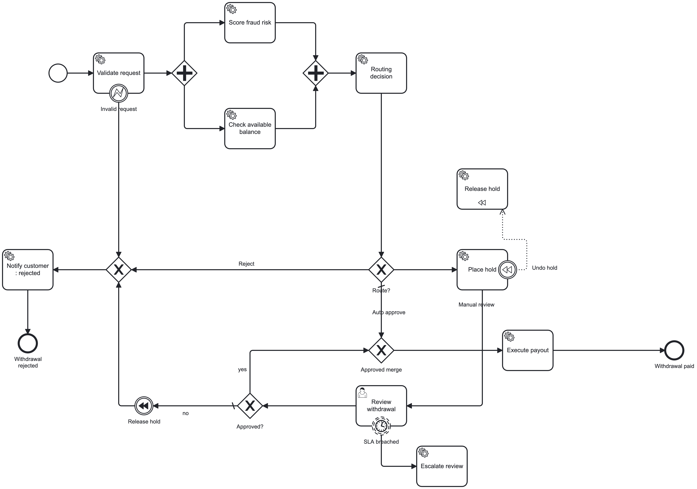

# Retirement Withdrawal Workflow

A Camunda 7 + Spring Boot workflow that processes retirement-account withdrawal requests end to end: validation, parallel risk checks, DMN-based routing, human review with SLA escalation, asynchronous payout with retries, and saga-style compensation.

Built to demonstrate production BPM patterns in a financial domain: transaction boundaries, at-least-once job execution, idempotent side effects, incidents, and compensation.

## Tech Stack

- Java 17, Spring Boot 3.5
- Camunda Platform 7.24 (embedded engine, Cockpit, Tasklist, Admin)
- DMN 1.3 (FEEL) for routing rules
- H2 (file-based for local runs, in-memory for tests)
- JUnit 5, AssertJ, Mockito, camunda-bpm-assert

## Process Overview



Source: [`src/main/resources/withdrawal-request.bpmn`](src/main/resources/withdrawal-request.bpmn). Open it in Camunda Modeler to view or edit.

## What Each Milestone Demonstrates

| # | Feature | Camunda concept |
|---|---|---|
| M1 | Embedded engine, Cockpit, Tasklist | Spring Boot starter, auto-deployment |
| M2 | REST start and status API | Business key as idempotency key, history queries |
| M3 | Request validation | `BpmnError` + error boundary event (business failure → modeled path) |
| M4 | Fraud and balance checks in parallel | Parallel gateway split/join, tokens |
| M5 | Routing rules | DMN decision table, hit policy FIRST, `DecisionService` |
| M6 | Manual review with SLA | User task, candidate groups, non-interrupting timer boundary event |
| M7 | Payout | `asyncBefore`, retry time cycle, incidents, idempotent side effects |
| M8 | Funds hold | Compensation boundary event, compensation throw event (saga) |
| M9 | Tests | DMN unit tests, process integration tests with manual job execution |

## Routing Rules (`withdrawal-routing.dmn`, hit policy FIRST)

| # | Condition | Route | Reason |
|---|---|---|---|
| 1 | `sufficientFunds = false` | REJECT | Insufficient funds |
| 2 | `fraudScore >= 80` | REJECT | High fraud risk |
| 3 | `fraudScore >= 50` | MANUAL_REVIEW | Elevated fraud score |
| 4 | `withdrawalType = "HARDSHIP"` | MANUAL_REVIEW | Hardship requires review |
| 5 | `amount >= 10000` | MANUAL_REVIEW | Large amount |
| 6 | otherwise | AUTO_APPROVE | Within auto limits |

Rule order defines precedence: the strictest outcome is listed first, and rule 6 is a catch-all so a decision always exists.

## Running Locally

```bash
mvn spring-boot:run
```

| UI | URL | Login |
|---|---|---|
| Cockpit / Tasklist / Admin | http://localhost:8080/camunda/app/ | `demo` / `demo` |
| H2 console | http://localhost:8080/h2-console | JDBC URL `jdbc:h2:file:<project>/data/camunda`, empty user and password |

Before testing manual review, create a `reviewers` group in Admin and add `demo` to it.

## API

### Start a withdrawal

```bash
curl -s -X POST localhost:8080/api/withdrawals -H 'Content-Type: application/json' \
  -d '{"requestId":"r-1","accountId":"ACC-1001","amount":500,"withdrawalType":"REGULAR"}'
```

- `201 Created`: new process instance started
- `200 OK`: a request with this `requestId` already exists, so the existing instance is returned (idempotent)

### Get status

```bash
curl -s localhost:8080/api/withdrawals/r-1
```

### Admin (fault simulation)

| Endpoint | Purpose |
|---|---|
| `POST /api/admin/gateway?up=true\|false` | Simulate the payment gateway recovering or failing |
| `POST /api/admin/crash-after-pay?on=true` | One-shot crash after money moves, to exercise idempotent retries |

## Test Accounts

| Account | Balance | Behavior |
|---|---|---|
| `ACC-1001` | 120,000 | Normal, low fraud score |
| `ACC-1002` | 5,000 | Use amounts above 5,000 for insufficient funds |
| `RISK-2001` | 90,000 | High fraud score (85) |
| `FAIL-3001` | 80,000 | Payout gateway fails until `gateway?up=true` |

## Scenarios

| Scenario | Request | Expected path |
|---|---|---|
| Auto approve | `ACC-1001`, 500, `REGULAR` | Payout → Withdrawal paid |
| Large amount | `ACC-1001`, 15000, `REGULAR` | Place hold → Review → approve/reject |
| Hardship | `ACC-1001`, 500, `HARDSHIP` | Place hold → Review |
| Insufficient funds | `ACC-1002`, 9000, `REGULAR` | DMN reject → Notify |
| Fraud | `RISK-2001`, 500, `REGULAR` | DMN reject → Notify |
| Gateway outage | `FAIL-3001`, 500, `REGULAR` | 3 attempts → incident → fix + retry in Cockpit → paid |
| Reviewer rejects | any review case, `approved=false` | Compensation releases hold → Notify |
| SLA breach | any review case, wait more than 1 minute | Escalation logged; review task stays open |

## Tests

```bash
mvn test
```

- **`WithdrawalRoutingDmnTest`**: evaluates the DMN directly (no Spring, no engine). Covers every rule plus boundary values (`9999.99` vs `10000`, fraud `49/50/79/80`) and rule precedence.
- **`WithdrawalProcessTest`**: Spring Boot integration tests with the job executor disabled, so tests trigger timers and async jobs explicitly with `execute(job(pi))`. Covers:
    - Validation rejection
    - Auto-approve with async payout
    - DMN rejection
    - Manual review approve (hold captured) and reject (hold compensated)
    - Non-interrupting SLA escalation
    - Payout failure → 3 attempts → incident → recovery

## Design Decisions

- **Delegate vs. Business Rule Task for DMN.** A `JavaDelegate` calling `DecisionService` gives one place for logging and null-guarding, and is unit-testable with a mocked `DecisionService`. A Business Rule Task needs less code and is the right choice when no extra logic is needed.
- **Business vs. technical errors.** Invalid input throws `BpmnError` and follows a modeled path. Gateway outages throw plain exceptions, so the engine retries and raises an incident. Mixing the two would either retry business rejections or silently swallow outages.
- **`asyncBefore` on payout only.** It isolates the unreliable external call into its own transaction, so earlier steps stay committed and the API returns immediately. Every async boundary adds a job row and latency, so boundaries are placed only where they buy isolation.
- **`R3/PT10S` means 3 total attempts**, not 1 + 3. Use `R4` for "one try plus three retries".
- **Idempotency at every side-effect boundary.** Jobs are at-least-once: a crash after the payout but before commit causes a retry. The payout is keyed by `requestId`, so a retry returns the original transaction instead of paying twice. API-level idempotency alone cannot prevent this, because the retry happens inside one instance.
- **Compensation instead of rollback.** The hold committed in an earlier transaction, so a rollback can't undo it. The reject path throws a compensation event that runs `Release hold` before the customer is notified. Place, release, and capture are all idempotent because compensation handlers can also be retried.
- **Non-interrupting SLA timer.** An SLA breach alerts a supervisor while the review continues. An interrupting timer would suit a hard deadline such as auto-reject after 72 hours.
- **Escalation is not an outcome.** Escalation uses a separate `escalate()` method so it never overwrites the terminal `outcome` variable.
- **History time-to-live** is set explicitly on every definition, as Camunda 7.20+ requires, because retention is a compliance decision in a financial domain.

## Production Gaps (Next Steps)

- Replace the in-memory payout and hold maps with database tables that have a unique constraint on `request_id`, or use the gateway's own idempotency keys.
- Represent money as `BigDecimal` end to end (currently `Double` in process variables).
- Return `endActivityId`, `route`, and `rejectionReason` from the status endpoint (read from history).
- Validate malformed requests at the controller (`@Valid`, 400) instead of starting an instance to reject them.
- Share one source of truth for withdrawal types between validation and the DMN.
- Make the SLA duration configurable (`${reviewSla}`).
- Use PostgreSQL in place of H2, add authentication, and use a clustered job executor.